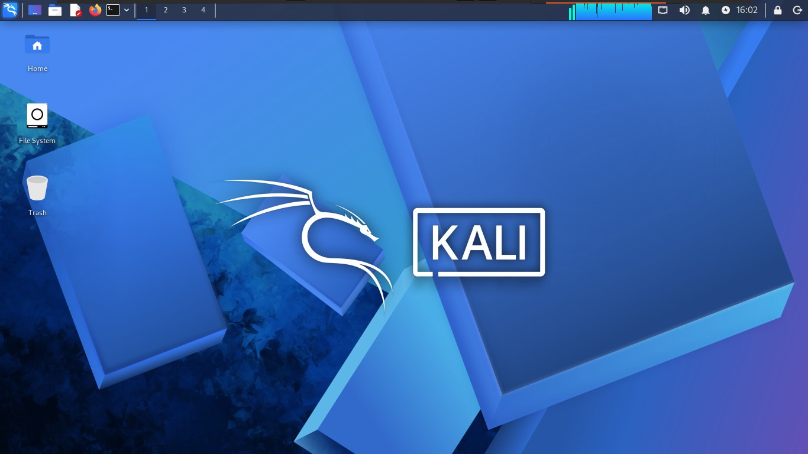
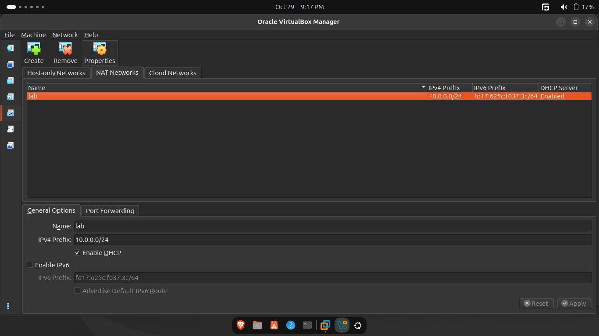

# Cybersecurity Virtual Lab Setup

Setting up a virtual cybersecurity laboratory using VirtualBox and Kali Linux as part of the Networkwalks cybersecurity training program.

## Project Overview

This project documents the configuration of my Kali Linux environment for cybersecurity practice using Oracle VirtualBox.

Since I had previously worked with Kali Linux and already had it installed, the main task was to adjust my existing lab configuration to meet the program's network requirements.

This involved creating a new NAT Network with the specified IPv4 subnet in VirtualBox, preparing the environment for future cybersecurity exercises.

## Objectives

- Review the existing Kali Linux virtual machine.
- Create a new NAT Network in VirtualBox.
- Configure the network to meet the program's specifications.
- Prepare the lab environment for future cybersecurity exercises.
- Document the configuration process.

## Lab Configuration

| Component | Configuration |
|---|---|
| Hypervisor | Oracle VirtualBox |
| Security OS | Kali Linux |
| Virtual Network | NAT Network |
| Previous Network Subnet | 10.0.3.0/24 |
| New Network Subnet | 10.0.0.0/24 |

## Lab Setup Procedure

### Step 1: Prepare the Existing Kali Linux Environment

Kali Linux was already installed in my VirtualBox environment, and I had previous experience working with the operating system.

Rather than performing a fresh installation, I focused on adjusting the existing lab configuration to meet the requirements of the training program.

**Screenshot: Kali Linux Environment**

### Step 2: Create a New NAT Network

A new NAT Network was created in VirtualBox to meet the program's specified network configuration.

My existing lab used the 10.0.3.0/24 subnet. I added a new NAT Network using the 10.0.0.0/24 subnet to align the environment with the required specifications.

A NAT Network allows compatible virtual machines connected to the same network to communicate with one another while providing outbound network connectivity.

**Screenshot: VirtualBox NAT Network Configuration**

## What I Learned

### 1. VirtualBox Networking

I gained further experience configuring virtual networks in VirtualBox and understanding how network settings support a virtual lab environment.

### 2. Network Configuration

I learned the importance of following specified network requirements when preparing a lab for structured cybersecurity exercises.

### 3. Lab Preparation

I gained experience adapting an existing virtual environment to meet new requirements instead of rebuilding the entire setup from scratch.

## Conclusion

The Week 1 project focused on preparing my existing Kali Linux environment to meet the network configuration requirements of the Networkwalks training program.

By creating a new NAT Network with the specified subnet, I took another step toward preparing my virtual lab for future cybersecurity exercises.

## Tools & Resources

- VirtualBox: https://www.virtualbox.org/
- Kali Linux: https://www.kali.org/

## Project Information

- **Program:** Cybersecurity at Networkwalks
- **Week:** 01
- **Project:** Cybersecurity Virtual Lab Setup
